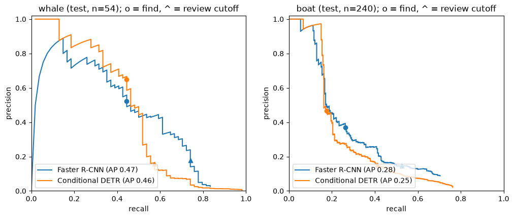
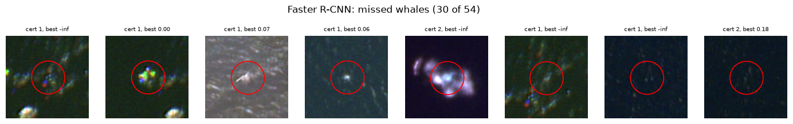
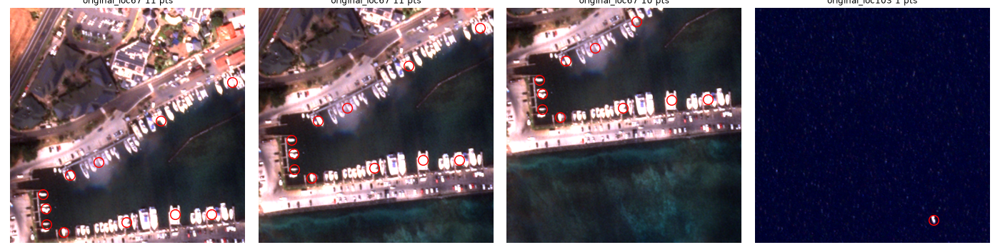
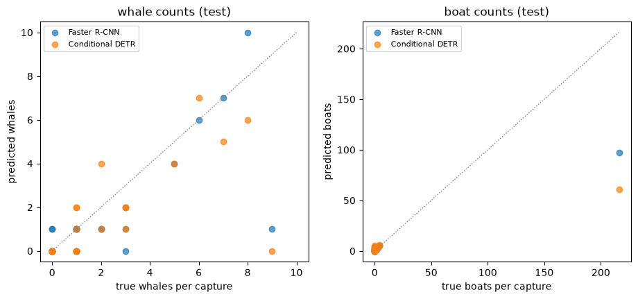

# First detector results (2026-11-16)

Two detectors, trained and tuned the same way on the same scene-grouped split, scored once on the
held-out test split. Full output: `checkpoints/executed/evaluate_detectors.ipynb`.

- **Faster R-CNN** (CNN baseline): ResNet-50 FPN v2, COCO-pretrained.
- **Conditional DETR** (transformer): ResNet-50 backbone, COCO-pretrained.

Test split: 280 chips (500 x 500 px, 0.5 m/px), 17.5 km2, **54 whales, 240 boats**. Brackets are
95% bootstrap confidence intervals over location groups.

## Summary

- **Whales: the two models are tied** (AP 0.47 vs 0.46). Whales are the hard class for both.
- **For a recall-first review, use Faster R-CNN**: it finds ~3 in 4 test whales at ~10 false
  alarms per km2. DETR is cleaner at stricter cutoffs but can't reach that recall.
- **Boats are fine in open water** (recall 0.94-1.00 on SkySat scenes). The low test boat AP comes
  from one marina with mostly unlabeled boats (see below), not from the models.
- **Weather augmentation** didn't change whale AP, but halved whale false alarms.
- **Counting:** both undercount whales by ~30%; per-capture counts are exact about half the time.

## Whales

| | Faster R-CNN | Conditional DETR |
|---|---|---|
| AP | 0.47 [0.29, 0.66] | 0.46 [0.29, 0.64] |
| "Find" cutoff: recall / precision | 44% / 52% | 44% / 65% |
| "Find" cutoff: false alarms per scene (~65 km2) | 81 | 48 |
| **"Review" cutoff (~10 false alarms/km2): recall** | **74%** | 57% |

Cutoffs are chosen on validation, then applied unchanged to test:
- **find**: best F2, a score that weights recall 4x as much as precision.
- **review**: the most whales found within a false-alarm budget of 16 per km2 (about one per chip).
- **count**: predicted total equals the true total (used only for counting).

What makes a whale easier or harder (test; small groups, read loosely):

| | Faster R-CNN recall | DETR recall | Whales |
|---|---|---|---|
| Certain whales | 69% | 54% | 13 |
| Probable whales | 37% | 41% | 41 |
| Calm water | 61% | 55% | 31 |
| Medium-rough water | 19% | 29% | 21 |

Both clearly beat an untrained bright-blob baseline (whale + boat AP 0.33 / 0.37 vs 0.13).

Missed whales are mostly faint, partly submerged, or sit in glint and clutter:

## Boats: the marina problem

Test boat AP is low (0.28 / 0.25) because **216 of the 240 test boats come from one location
(`original_loc67`), a marina.** Training and validation boats are almost all single boats in open
water, and only ~11 of the dozens of docked boats per chip are labeled, so correct detections of
unlabeled boats count as false alarms.

Red circles are the labeled boats. On the SkySat test scenes (24 boats) boat recall is 0.94-1.00
with few false alarms, matching validation (boat AP 0.94 / 0.96). **Boat results should be
reported with the marina separated, and its labels completed or the location dropped.**

## Counting ("how many whales are in this image?")

| | Faster R-CNN | Conditional DETR |
|---|---|---|
| Predicted / true whales | 39 / 54 | 37 / 54 |
| Mean error per capture | 0.92 | 1.08 |
| Captures counted exactly | 52% | 40% |

## Weather augmentation ablation (DETR, with vs without)

| | Difference (with - without) [95% CI] |
|---|---|
| Whale AP | -0.003 [-0.08, 0.07] |
| Whale false alarms per km2 | **-0.63 [-1.30, -0.10]** |

No effect on finding whales; fewer false alarms from clutter. (Boat differences are driven by the
marina and aren't meaningful.)

## Limitations

- **Few whales:** 54 test and 59 validation whales, hence the wide confidence intervals.
- **Point labels:** whales are labeled as points, so the boxes are fixed-size squares and scoring
  is by distance (a detection within 10 m counts).
- **Noisy cutoffs:** cutoffs chosen on 59 validation whales may shift on new scenes.
- **Marina labels:** the marina's labels are incomplete (above).

## Suggested next steps (details in `TODO.md`)

1. **Learning curve**: retrain on 25/50/75% of the training scenes to test whether more labeled
   whales would help.
2. **Retune for whale AP** instead of mean AP (boat AP was saturated, so the search mostly chased
   noise).
3. **Fix or separate the marina** in the boat results.
4. Optional: dropout search for DETR, copy-paste whale augmentation, RGB + NIR input.
